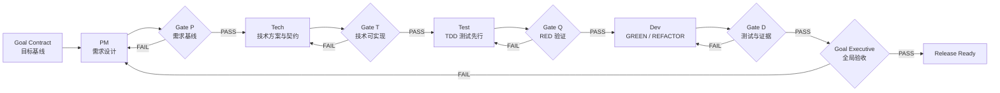

# Dev Flow v1.0 — 目标约束、测试先行的 Agent 研发流程

> 适用对象：以软件产品/应用为交付目标的单 Agent 或多 Agent 研发项目。
> 核心原则：Goal Contract 不因任务拆分而失效；上游交付有契约，下游实现有证据；Test 在 Dev 之前，执行 RED → GREEN → REFACTOR。

## 1. 目标与边界

本流程服务于一个全局目标（Goal）。Goal Executive 负责解释和维护目标，PM、Tech、Test、Dev 负责各阶段交付。同一个 Agent 可以顺序承担这些职责，不自动启动其他 Agent。

本轮接入的是流程契约和 Agent 审查指引：各 Gate 由 Agent 根据实际检查结果记录 PASS / FAIL / BLOCKED / NOT_RUN；没有安装自动 Harness、CI 强制门禁或多 Agent 调度器。Hooks 仍只提醒，不阻断工具、不批准变更。缺失必需证据时不得宣称阶段通过。

### 与 AI-Native-Scrum 的衔接

| 阶段 | 现有入口 / 正本 | 交接要求 |
|---|---|---|
| Goal Baseline | `.ai/skills/goal-intake/SKILL.md`；`raw/goals/GOAL-*.md` | 明确人工批准、revision、GSC-*、Protected Constraints |
| Brief → Research → Decision → Solution | `.ai/skills/solution-pack/SKILL.md`；`wiki/solutions/SOL-*.md` | AI 起草 Brief 并经人确认；Research 证据可回查并标明性质；AI 给出推荐，人做选择并留确认记录；Solution 承接已决定的方向；涉及产品取舍时按 `product-director` 演出业务分镜、一轮一个关键决策 |
| PM | `.ai/skills/goal-to-backlog/SKILL.md`、`.ai/skills/story-refine/SKILL.md`；`wiki/workitems/` | Story、AC、Goal 关联及适用的菜单/模块/功能映射；六维需求契约经 `.ai/tools/check_requirements.py` 报告 READY（仅结构与引用）；用户可见流程按 `experience-director` 写明体验意图并转成可观察 AC |
| Tech | `.ai/skills/story-to-tasks/SKILL.md` | 检查已确认的设计与接口契约，分配设计、测试、实现和跨仓集成任务；未通过 Tech Gate 不进入正式测试交接 |
| Test → Dev | `.ai/skills/delivery-loop/SKILL.md` | 可执行的行为 RED → 最小实现 GREEN → 重构及回归；保留原始失败证据 |
| Goal Acceptance | `.ai/skills/lint/SKILL.md`、`delivery-loop` | 汇总原始目标、硬约束及跨 Story/跨仓证据，交人工最终验收 |

Goal Contract 唯一正本是 `raw/goals/GOAL-*.md`，不另建 `.goal/contract.yaml`。Story/Task 沿用 `schema/id-policy.yaml` 的标识和 `GOAL-XXX#GSC-XX` 关联；决策与获批变更记录在 `wiki/decisions/` 并引用 Goal revision。目标变更先在 `intake/` 待审，批准后才更新正本。

以下产物清单是完整软件应用的基线。实施前按 Story 声明 Web、数据库、API、自动化测试等适用性和实际路径；复用现有目录，不搬迁已有代码。脚本、文档、无 UI 或无数据库项目，可以用已有产物/人工验证替代不适用项，但须记录理由、验证方式并获得明确批准；不得默默跳过关键 AC 或以空文件通过。初始化只安装流程资料，不创建产品设计、测试占位或业务代码。

多子仓库项目可在没有 `.git` 的协调根目录使用本流程。根目录记录全局目标与跨仓追溯，每项设计、Task 和证据标明所属子仓库、责任人、依赖及验收命令。Git 证据按子仓库记录各自 revision；非 Git 文件记录路径与内容哈希。子仓库规则仍适用，不递归初始化、改写或自动提交子仓库。局部测试通过后，仍须验证跨仓接口及全局核心旅程。

主线：Goal → Brief → Research → Decision → Solution → Story → Task。PM / Tech / Test / Dev 是贯穿这条主线的职责，不是另一套并行流程；Decision 不代替 Goal 批准或最终验收。

核心不变量：

1. 原始目标、关键范围、不可妥协约束只可通过受控的 Goal Change Request 变更。
2. 每个 User Story 都有稳定 ID、验收条件和 Goal 关联。
3. 每个技术设计对象均能追溯到模块/功能/故事；必要的基础设施例外必须说明理由。
4. 每个可测试的验收条件都有对应测试（Unit/Component/Contract/Integration/E2E 中一种或多种）。
5. 测试不能为使开发通过而被单方面删除、弱化或篡改。
6. 局部完成不代表整体交付；最终验收必须回到全局目标。

## 2. 总体流程



注意：图表示逻辑依赖，不意味着同一时刻只能有一个角色工作。需求与接口基线确认后，各 User Story 可以按纵向切片推进；并行 Agent 工作另需明确授权，发布时统一验证全局目标。

## 3. 各角色交付契约

### 3.1 PM — 产品需求设计

**强制交付**

| 交付物 | 建议路径 | 最少应包括 |
|---|---|---|
| 用户故事地图 | `docs/product/user-story-map.md` | Persona、用户活动、旅程、Story ID、优先级、版本切片、验收条件 |
| 菜单设计 | `docs/product/menu-design.yaml` | 导航层级、菜单 ID、页面 ID、角色权限、对应功能 ID |
| 模块设计 | `docs/product/modules.yaml` | Module ID、责任边界、依赖、业务对象、功能清单 |
| 功能设计 | `docs/product/functions.yaml` | Function ID、触发条件、输入、输出、业务规则、异常状态、关联 Story ID |

**Gate P：** 所有 in-scope Story 有验收条件和 Goal 映射；菜单—页面—模块—功能关系不冲突；业务术语明确；待确认事项可见而未被默认当作事实；范围变更获得批准。

### 3.2 Tech — 架构与设计

**强制交付**

| 交付物 | 建议路径 | 最少应包括 |
|---|---|---|
| 技术基座架构（Mermaid） | `docs/architecture/platform.mmd` | 技术栈、客户端、服务端、存储、集成、鉴权、观测与边界 |
| 应用功能架构（Mindmap） | `docs/architecture/features.mmd` | 模块、页面、功能分层，以及 PM Function ID |
| App Shell（HTML） | `prototypes/app-shell.html` | 全局布局、导航、权限入口、状态区、响应式约束 |
| 页面示例（HTML） | `prototypes/pages/*.html` | 至少覆盖关键页面类型与主要交互状态 |
| 后端数据库设计 | `docs/architecture/database.md` + `db/schema.sql` | 数据实体、主外键、约束、索引、迁移策略、数据字典 |
| **API / Interface Contract（补充）** | `contracts/openapi.yaml` 或 `contracts/interfaces.*` | 请求/响应、错误码、DTO、领域接口、版本约束 |

**Gate T：** Story / Function 能定位到对应技术实现边界；界面原型覆盖主要用户路径；测试团队有稳定可依赖的接口契约；数据库设计支撑业务规则；架构决策未违背 Goal Contract。对于非 Web 应用，HTML 交付的豁免应显式说明并经批准。

### 3.3 Test — 测试先行（TDD）

**强制交付**

- `tests/unit/**`：由用户故事及其验收条件推导的单元测试。
- `tests/component/**`：必要的 UI/组件行为测试。
- `tests/contract/**`：必要的接口契约测试。
- `tests/e2e/**`：覆盖核心用户旅程的端到端测试（可在对应代码具备后运行）。
- Story 的 `json requirement-contract` 块：Story → AC → TC 的唯一机读追溯正本，不另建追溯文件。
- `raw/evidence/TASK-*/`：`evidence.py` 记录的 RED，绑定命令、测试文件哈希和所覆盖的 TC。

**TDD 细则：**

1. 按 Story 验收条件拆分测试，不直接把高层故事机械翻译为单个 Unit Test。
2. 先确认 Tech 的 API/Interface Contract；由 Tech 提供可加载但未实现业务行为的接口骨架（仅在必要时）。
3. RED 应由行为尚未实现导致的断言失败产生；语法错误、配置错误、缺少依赖和无法导入模块不算合格 RED。
4. 固化预期行为与测试证据；Dev 不得擅自修改/删除测试以换取 GREEN。
5. 发现用户故事或接口契约冲突时，提出澄清/变更请求（`wiki/changes/CR-*.md`），而不是悄悄调整期望。
6. 每个 Goal 在拆 Task 前由 TDD 导演（`tdd-director`）做一轮引导：每个 TC 写明它必须拒绝的错误实现；GREEN 必须重复同一 RED 的命令，且测试文件未变。

**Gate Q：** 关键 AC 有测试且 Traceability 完整；测试套件可运行；RED 失败原因正确；测试断言不是空断言或恒真断言。

### 3.4 Dev — 基于测试与设计开发

**强制交付**

- `src/**`：按 Tech 契约实现的产品代码。
- `db/migrations/**`：数据库变更与兼容处理（若适用）。
- `docs/development/implementation-map.yaml`：Function/Test → 实现位置的追溯映射。
- `reports/test-results/**`：自动化测试结果。
- `wiki/reviews/REV-GOAL-*.md`：复盘导演（`review-director`）带着 Goal 目的做的验收复盘报告；`check_acceptance.py` 给出 Goal → AC → TC → 证据链。

**TDD 循环：** RED（由 Test 交付）→ GREEN（最小满足断言的实现）→ REFACTOR（在测试保护下改善设计）→ Regression（回归测试）。

**Gate D：** 必须的单测/契约测试通过；回归测试通过；数据库迁移可验证；没有未审批的目标变更；证据与目标覆盖矩阵完整。对于尚无法自动化的条件，记录人工验证步骤和责任人。

## 4. Goal Executive 跨阶段职责

Goal Executive 并不是第五个开发角色。它持续检查：

- `goal_alignment`：当前设计、测试、代码是否仍满足原始 Goal；
- `scope_integrity`：有无未审批地删除、弱化或新增范围；
- `traceability`：Goal → Story → Function → Design → Test → Code → Evidence 能否贯通；
- `unresolved_risks`：未解决的问题是否会影响最终目标；
- `acceptance`：是否有足够证据可以宣称目标完成。

目标评估状态：`ON_TRACK` / `AT_RISK` / `BLOCKED`。`ACCEPTED` 仅记录人工最终验收结果，不是 Agent 自评状态，也不是工作项的 `status`。语义偏离由 Goal Executive 做解释性判断；未来自动门禁需要另行实现和验证，当前以实际执行证据及人工授权为准。

## 5. 阶段门禁

| 门禁 | 触发时机 | 强制校验 | 失败处理 |
|---|---|---|---|
| G0 Goal Baseline | 正式规划前 | Goal Contract、范围与不可变约束已明确 | 请求澄清，禁止下游进入正式实施 |
| G1 PM Gate | PM 交付后 | Story—AC—Goal 完整；菜单/模块/功能映射 | 退回 PM |
| G2 Tech Gate | Tech 交付后 | 所有强制技术交付物存在；接口及数据契约可测试 | 退回 Tech |
| G3 Test RED Gate | Test 交付后 | 测试覆盖 AC、测试可运行、行为 RED 有效 | 退回 Test/Tech |
| G4 Dev GREEN Gate | Dev 交付后 | 单测/契约/集成/必要 E2E 全通过，证据齐全 | 退回 Dev，必要时发起设计变更 |
| G5 Goal Acceptance | 版本交付前 | 原始目标约束满足；审查所有风险/变更 | 未通过则不得标记 Release Ready |

**不要把测试数量或通过率单独当作目标完成的替代指标。** 核心硬约束必须逐项通过。

## 6. 追溯模型与样例

沿用 `schema/id-policy.yaml` 的稳定标识：Goal 使用 `GOAL-*`、Story 使用 `STORY-*`、Task 使用 `TASK-*`；Story 内的 AC 使用带 Story 上下文的引用。模块、功能、测试 ID 是产物内部标识，不自行扩展实体类型。

```text
GOAL-001  完整的双人五子棋游戏
  └─ STORY-003  玩家连续五子时判定胜利（goal_success_criteria: [GOAL-001#GSC-01]）
      ├─ AC-003-01  横向、纵向及双对角线均可判定
      ├─ FUNC-012  evaluateWinner(board, lastMove)
      ├─ TC-021  test_horizontal_five_wins
      ├─ TC-022  test_diagonal_five_wins
      └─ CODE     src/domain/win-rules.ts
```

门禁检查不应只验证 ID 存在，更应验证 Test 覆盖了 AC 的行为、Dev 实现与接口契约一致、Evidence 能对应具体代码版本。

## 7. 工作项流转与返工机制

阶段审查顺序为 `GOAL_BASELINE → PM_GATE → TECH_GATE → TEST_RED_GATE → DEV_GREEN_GATE → GOAL_ACCEPTANCE`，阶段结论记录于工作项的 Execution Evidence，并关联证据路径。

工作项 `status` 继续遵守 `schema/workitem-types.yaml`：`proposed → backlog → refining → ready_for_task_decomposition → ready → in_progress → review → done`（`planned` 等其他合法状态按既有规则使用）。Task 的状态只能按 `transitions` 迁移，每次在 Status History 追加一行（角色、执行者、依据）：实现者不把自己的工作从 `review` 改成 `done`，`blocked` 要写明 `blocked_by` 与 `resume_state`，`cancelled` 只由人决定；等人决定的问题记在 `wiki/decisions/HUMAN_DECISIONS.md`。精炼完成不等于 Ready Pool、GREEN 不等于业务验收；不得把阶段 ID 或 `RED_VERIFIED`、`ACCEPTED` 写入 `status`。目标通过后也不自动修改 Goal 的 `approved` 状态。

如果发现问题：

- **目标变化**：必须创建 `GoalChangeRequest`，批准后更新 Goal Contract 版本，并标记所有相关交付物需要重审。
- **需求缺漏**：回到 PM 更新 Story/AC，显式记录受影响的 Tech/Test/Dev 工作项需复核，保留历史证据；没有自动失效引擎。
- **接口变化**：回到 Tech 更新 Contract，Test 必须确认旧断言是否仍成立。
- **代码缺陷**：Dev 修复，不能擅改测试来掩盖问题。
- **测试预期错误**：Test 修改测试，但要记录原因，并由 PM/Tech 审核行为是否符合原目标。

获得授权后允许以 Story 为单位并行推进，不能绕开相应 Story 的 Gate。合并与发布时必须进行跨 Story 的全局回归；Release Ready 不授权提交、推送或部署。

## 8. 仓库推荐目录

```text
project/
├─ AGENTS.md
├─ dev-flow.yaml
├─ Goal_Constrained_Dev_Flow_v1.md
├─ raw/goals/          # 批准的 Goal Contract
├─ intake/             # 待审批变更
├─ wiki/
│  ├─ workitems/        # Story / Task 正本
│  └─ decisions/        # 决策与获批变更
├─ docs/
│  ├─ product/
│  │  ├─ user-story-map.md
│  │  ├─ menu-design.yaml
│  │  ├─ modules.yaml
│  │  └─ functions.yaml
│  ├─ architecture/
│  │  ├─ platform.mmd
│  │  ├─ features.mmd
│  │  └─ database.md
│  └─ development/
│     └─ implementation-map.yaml
├─ contracts/
│  └─ openapi.yaml
├─ prototypes/
│  ├─ app-shell.html
│  └─ pages/
├─ db/
│  ├─ schema.sql
│  └─ migrations/
├─ src/
├─ tests/
│  ├─ unit/
│  ├─ component/
│  ├─ contract/
│  └─ e2e/
└─ reports/
   └─ test-results/
```

## 9. 当前落地边界与后续建议

1. 本轮已接入 AI-Native-Scrum 的 Skill、正本边界和工作项状态；`dev-flow.yaml` 是供 Agent 阅读的自定义 DSL，不是原生可执行配置。
2. 在获批的实际 Story 上先用人工/Agent 审查执行阶段交接；五子棋仅为示例，不是初始化后的默认任务。
3. Bootstrap 自检只验证生成与有限流程合同，不验证真实项目的全部门禁。自动验证器、CI Required Check、多 Agent 调度及 MCP 服务均需另行批准、实现和验证。
4. 不把本轮流程接入当作自动门禁、真实产品验收或发布成功。

## 10. 实际项目的阶段审查准则（需执行并记录证据）

- 无关联 Goal 的正式 Work Item 被 Gate 拒绝。
- 删除一个必需的 PM/Tech 交付物，阶段 Gate 明确失败。
- 关键 AC 没有测试，Test Gate 明确失败。
- Dev 试图删除测试或未经批准改变 AC，触发审查。
- 某个 Story 本地通过，但跨模块 E2E 或终局规则失败时，Goal Acceptance 拒绝发布。
- 所有强制条件满足、测试结果可复现且变更记录完整时，可以进入人工最终验收。
