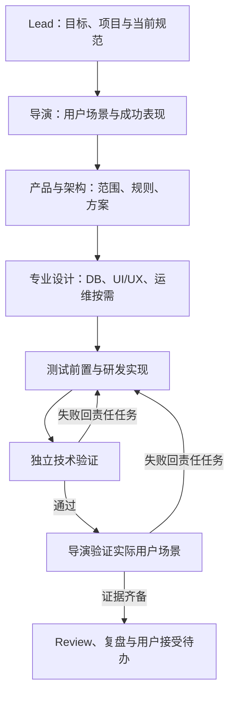

# Lead 研发闭环：角色、执行、联合验收与返工

状态：源码级候选；基于 PR #25，保留默认规划模式。一个目标对应一轮有明确终点的研发迭代。完整概念沿用 [Sprint RFC（PR #22）](https://github.com/zljie/AI-Native-Scrum/blob/7522a637b8bece5cf61c91a78e0917b325d9d034/docs/iterations/SPRINT-ORCHESTRATOR-RFC.md)，本页说明当前实际接缝与使用条件。

**当前可交付：** 通用 Lead 规划/交付/恢复合同、八角色 opt-in 配置、现有 Engine 的显式任务图入口、从同一 Journal 派生的联合检查。**当前未跑通：** 用户真实 Codexhost 到 Engine 的执行适配，以及真实项目的完整联合验收；这些保持 BLOCKED / NOT_RUN。

## 1. 用户始终在主聊天推进同一轮



图表示责任和回流关系，不表示所有角色自动并发或每轮全员启动。当前 Engine `drive` 顺序执行 ready 节点；显式并发仍须满足原有资源和写域检查。工程检查、导演报告、用户业务接受与发布分别判断。

| 主聊天意图 | 实际行为 |
|---|---|
| 默认 `$ans-lead`、先分析/制定计划 | 导演 → 产品/架构 → 计划，止于规划 |
| 开展迭代/按已有授权推进研发 | 复用当前计划，检查项目准入和执行入口，继续到获准交付终点 |
| 继续/恢复/查进展 | 查询原任务、实例与 Journal，核对当前版本及未确认副作用 |

已有范围内的研发与修复不在每个阶段重复申请权限。main 合并、生产数据库、部署、扩大权限和发布仍分别需要明确授权；Lead 先准备可评审差异与证据，再停在具体动作前。

## 2. 通用职责与项目实例分开

全局 `ans-lead` 只保存流程。每个真实项目提供自己的 API、前端框架、SDD、数据、测试、运行规范及角色配置，并绑定来源版本。不得把项目 A 的规范、线程或结果写入全局 Skill 后带到项目 B。

| 角色 | 主要产物 | 介入依据与回收 |
|---|---|---|
| Lead | 本轮目标、工作单、回收、分层 Review/Retro | 主聊天协调；引用既有 Goal/Task/Journal |
| 导演 | 场景合同、真实场景回放报告 | 用户路径/业务行为影响；前置设计、后置验收 |
| 产品 | 规则、首轮范围、故事与 AC | 目标/业务影响；收尾核对范围，不代用户接受 |
| 架构 | 资产与技术约束、依赖、实现后架构事实 | 沿用实际 API/跨模块/数据/运行影响 |
| 数据库 | 模型/迁移/兼容性及隔离验证方案 | `database_schema` 的当前影响证据；有 DB 文件不等于需改表 |
| UI/UX | 交互状态、信息层级、组件与反馈要求 | `ui_flow` 的当前影响证据，复用本项目组件和规范 |
| 研发 | 当前范围代码/配置差异与可验证增量 | 设计交接、授权、测试前置条件均满足 |
| 测试 | 前置测试、当前版本独立验证、可复现缺陷 | 实施前/后及返工后；测试与场景结论分开 |
| 运维 | 运行、观测、交付与回退条件 | 运行/环境/交付影响；本配置不执行生产部署 |

`collaboration/sprint/registry.json` 是默认六角色模板加导演/UIUX 的参考注册表，不是已加载的宿主角色证明。原角色路径和方法保持复用；导演/UIUX 的合同/profile 放在受保护的项目 `schema/collaboration/sprint/` 下，作为 Engine 任务上下文读取，不自动写入用户级宿主配置。

已有项目角色定制时，先将参考注册表/策略与现有配置比较，保留实际 role/profile/skill 绑定；不要用默认模板静默替换项目要求。若项目要求 INIT-S2 准入，使用其实际可用且已核实的入口；普通 `v15_controller plan` 不能代替该准入。

## 3. 本轮代码如何接到已有底座

| 资产 | 本轮行为 | 证据边界 |
|---|---|---|
| `skills/ans-lead/` | 默认 plan；明确交付意图读取 `references/delivery-loop.md`；恢复先查询原轮 | Skill 文本不自动执行或授予权限 |
| `collaboration/sprint/` | 8 个专业角色、13 个候选步骤，沿用既有 signals/phase | 未默认嵌入；只激活信号匹配的节点 |
| `v15_controller plan --registry --policy` | 将明确选定的配置交给原 Activation 与 Engine.create | 默认值不变；plan 建 Journal，不调用模型 |
| `make_plan` | 拒绝任务写授权覆盖 registry/policy/角色合同/profile/Skill | 按实际安全路径比较，元数据及其祖先写域冲突在计划阶段拒绝 |
| `Engine.packet` | 提供当前 Goal/Story/Task、sample_kind、attempt 和传递前置产物清单 | 执行包要求前置完整；交接审查包可为部分清单，不能冒充执行包 |
| `sprint_flow.py preview` | 对已准备的 task-context 调原 make_plan，显示任务图与跳过原因 | 只读，不建 Journal、不授予授权 |
| `sprint_flow.py check` | 读取原 check/graph/metrics/history，核对场景合同与报告 | 只读；不 retry、不 finish、不改 Goal 状态 |

仍复用原 Engine 的当前交接接受、受限产物应用、RED/GREEN、有限尝试、失效传播、恢复核对和唯一 Journal；复用 V1.3 观测。共享上下文漂移可能保守阻断整个 run，不宣称已实现精确最小传播或完整 Token 总量。

通用 Engine/controller 的小改动已同步到 `initdir.sh` 嵌入版本；新增 Sprint 角色、策略与检查器仍是源码级选用资产。默认安装不会自动变成八角色 Sprint，也没有新增全局安装动作。

## 4. 源码级试用顺序

在包含本轮候选提交的完整 ANS 源码目录执行，操作对象是已获准的隔离项目。所有占位路径必须替换为真实路径；以下步骤不是用户批准记录，也不会自动获得业务接受。

### 4.1 准备当前项目配置

1. 按 [Lead Quickstart](lead-quickstart.md) 安装/更新通用 Skill。
2. 确认项目已有本轮所需的 ANS 工具、Goal/Story/Task、真实规范和授权来源；非 ANS 项目先完成获准接入。不能为演示照抄 fixture 的 approved/accepted。
3. 审阅 `collaboration/sprint/`。在目标项目尚不存在的 `schema/collaboration/sprint/` 中放入已审阅的这组资产；已存在时先比较、保留定制，禁止无条件覆盖。
4. 核对所选 registry 的每个合同/profile/Skill 引用实际存在且符合本项目要求；所选 policy、上下文与授权不能落在本轮可写范围内。测试/场景产物的写域需来自真实已有授权。
5. 使用实际 Context Pack 与影响复核准备任务。`director_pre` / `director_verify` 在 `ui_flow` 或 `business_rule` 时选中；`uiux_design` 只在 `ui_flow` 时选中。仅有文件存在不触发角色。

### 4.2 只读预检与创建计划

已有 `task-context/v1` 文件时，可先做只读预检：

```bash
python3 collaboration/sprint_flow.py --root /absolute/authorized-project preview \
  --context intake/task-context.json \
  --registry schema/collaboration/sprint/registry.json \
  --policy schema/collaboration/sprint/policy.json
```

准备好实际 `activation-request/v1` 后，且项目不要求另行角色准入时，可显式创建原 Engine 的计划：

```bash
python3 collaboration/v15_controller.py --root /absolute/authorized-project plan \
  --request intake/activation-request.json \
  --context-out generated/reports/sprint-task-context.json \
  --registry schema/collaboration/sprint/registry.json \
  --policy schema/collaboration/sprint/policy.json
```

以上文件名是接口示例。选择真实未使用的输出位置，重复创建会拒绝覆盖；run_id 来自实际请求。创建计划不是“所有角色已启动”。若项目要求 [INIT-S2 准入（PR #24）](https://github.com/zljie/AI-Native-Scrum/blob/c1699fc2753c6d43eba5d27631b928971276562c/docs/iterations/PROJECT-AGENT-INITIALIZATION-S2.md)，将同版 registry/policy/context 和已复核角色资料交给其实际入口，不能先用普通 plan 绕过。该候选未包含在本分支，需单独核验可用性。

### 4.3 执行入口的真实限制

原 Engine 通过 `CodexAdapter` 受控执行；本轮未放宽真实 adapter 检查。Codexhost `delegate start` 返回的独立 Thread 不能直接作为它的执行回执。当前 adapter 的宿主协议兼容性、登录、权限与真实原生子 Agent 仍须实测，CLI 存在不能证明可执行。

因此本指南不提供一条直接跨过宿主检查的执行命令。通过实际宿主检查后，沿用原 `v15_controller` / `agent_collaboration` 帮助中的获准 dispatch/drive/review 接口，并持续读取真实结果。需要新接入时停在明确 blocker，不伪造 adapter、回执、批准或 fixture 的 real 标签。

当前 INIT-S2 同一 run 只能给同一个 role_id 绑定一个 variant；前后端 profile 同时存在不等于本轮已经支持两者并发执行。

## 5. 联合验收检查

导演前置产出 `sprint-scenario-contract/v1`，后置产出 `sprint-scenario-review/v1`。完整字段与示例在 [场景合同](../collaboration/sprint/CONTRACT.md)。这些文件必须分别来自该 run 的 `director_pre` / `director_verify` 当前产物，不是操作员任意填写 PASS 后即可被采用。

```bash
python3 collaboration/sprint_flow.py --root /absolute/authorized-project --run-id RUN-ACTUAL-001 check \
  --contract outputs/director-scenarios.json \
  --report outputs/director-verification.json
```

也可省略两个引用，由检查器在对应当前产物中识别唯一的契约/报告；缺失或歧义均不判通过。采用当前代码版本真实写出的路径，不能把此处示例当作已有产物。

检查器要求：

- 工程检查成立，当前依赖交接、测试与产物没有失效。
- 角色、能力、run/task/sample_kind、当前 attempt 与 Journal 实例关系正确。
- 场景合同及报告确实归属对应当前节点，文件哈希当前。
- 报告覆盖完整场景清单，全部必验场景为 PASS；FAIL / NOT_RUN 保留并阻断。
- `checked_hashes` 覆盖当前合同及导演验收全部传递前置产物；证据文件存在且哈希当前。
- 前后 Journal 末条序号/哈希一致，避免在一次评估里混合不同快照。

`structural_checks_passed` 只说明这些结构与当前记录检查通过。报告中的 PASS 是有归属和版本绑定的记录结论，不自动证明观察内容真实、不认证真人，也不替代用户业务接受。fixture 完整走图后仍显示真实宿主/原生验收 NOT_RUN。

检查只返回工程、场景、未完成项和返工建议；不会调用 retry、结束 run、关闭业务目标或授权发布。命令返回 0 为联合结构检查通过，1 为有未通过项，2 为无效调用/输入。

## 6. 返工和收束

Lead 阅读实际失败证据后，将问题退到责任设计/implementation/database 任务。调用当前版本的既有 retry，会使下游交接/验收失效并保留旧 attempt；只读建议本身不执行该动作。修复后测试与受影响场景按新版本重验。

需求/规范漂移沿用 record-drift/replan；中断沿用 recover/reconcile，副作用不明时继续阻断。已有授权覆盖的修复继续推进，超出范围则先交付可评审结果再请求所需决定。

最终 Review/Retro 至少回答：本轮交付了什么、当前版本技术测试怎样、导演场景怎样、用户是否已经接受、发布是否获准、未完成项由谁处理及从哪里恢复。把改进写入既有 Backlog/LRN/ADR，不因时间盒结束或报告生成就自动接受业务目标或启动下一轮。

## 7. 仍需真实项目完成的门槛

| 条件 | 当前状态 | 必须取得的证据 |
|---|---|---|
| Codexhost → Engine 适配 | 未实现 / BLOCKED | 受支持的真实接口、有效权限、启动/结果/交接/失败回执 |
| 用户登录宿主全链路 | NOT_RUN | 导演到设计/实现/独立验证的真实实例和当前产物 |
| 测试与导演联合验收 | NOT_RUN | 实际产品路径回放、测试与场景分别判定，真实问题按需返工 |
| 两项目规范隔离 | NOT_RUN | 两个获准真实项目各自规范、线程、上下文与结果 |
| 漂移、中断恢复、更新/回退 | NOT_RUN | 对应真实条件下的版本失效、受控恢复和回退记录 |
| 用户接受、main 合并、发布 | 未自动授予 | 有权人的实际决定与独立操作证据 |

真实纵向切片优先复用现有 V15-AT-001 设备台账的编辑/显示/筛选场景，前提是能够访问实际存在且获准的项目副本。不要另建演示项目替代用户已有项目，也不人为编造一次真实缺陷。V1.5 发布继续按 [原门禁](iterations/V1.5-RELEASE-GATES.md) 评估。
